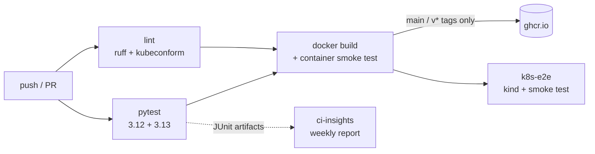

# Moshi Voice Chatbot

[](https://github.com/niushamjd/moshi-voice-chatbot/actions/workflows/ci.yml)
[](https://github.com/niushamjd/moshi-voice-chatbot/actions/workflows/ci-insights.yml)
[](https://github.com/niushamjd/moshi-voice-chatbot/pkgs/container/moshi-voice-chatbot)

Real-time, full-duplex voice chat with [Kyutai's Moshi](https://github.com/kyutai-labs/moshi) running locally on Apple Silicon via MLX. You talk, Moshi listens and answers at the same time, and audio streams both ways over a WebSocket.

## Platform / CI-CD

The model needs Apple Silicon, but everything around it (server, wire protocol, browser client) also runs with an **echo backend** that sends your audio straight back. That is what CI, the Docker image and Kubernetes use. Every push and pull request is linted, tested on Python 3.12 and 3.13, built into a container that is smoke-tested over a real WebSocket, and deployed to a throwaway kind cluster and smoke-tested again. Merges to `main` publish the image to ghcr.io. A weekly job reports on the pipeline itself: build times, failing and flaky tests.



| | Where |
|---|---|
| Pipeline | [`.github/workflows/ci.yml`](.github/workflows/ci.yml) |
| Container | [`Dockerfile`](Dockerfile) (~200 MB, non-root, health check) |
| Kubernetes | [`k8s/`](k8s/), [`scripts/kind-up.sh`](scripts/kind-up.sh) |
| Pipeline report | [`tools/ci_insights/`](tools/ci_insights/), [`.github/workflows/ci-insights.yml`](.github/workflows/ci-insights.yml) |

## How it works

```
Browser                                              Python server (backend/)
mic → AudioWorklet (24 kHz PCM)                      
    → WebCodecs Opus encoder → Ogg pages ──WS──▶  Ogg/Opus decode → 80 ms frames
                                                       → Mimi encode → Moshi LM step → Mimi decode
speakers ← AudioWorklet jitter buffer                  ↓ text tokens
    ← WebCodecs Opus decoder ← Ogg pages ◀──WS──  Ogg/Opus encode
```

- **`backend/server.py`**: aiohttp WebSocket server, which also serves the frontend. It handles one conversation at a time; a second client gets a "server busy" error.
- **`backend/moshi_runner.py`**: runs Mimi encode, the Moshi LM step and Mimi decode on three separate threads, so the stages overlap. On an M1 Pro each stage alone takes ~25 / ~50 / ~25 ms. Run in sequence that's ~90 ms, over Moshi's 80 ms frame budget. Pipelined, it averages ~65 ms per frame. Model state resets at the start of each conversation.
- **`backend/audio_utils.py`**: the wire protocol and PCM framing.
- **`frontend/`**: vanilla JS, no build step. `ogg.js` packs and unpacks Ogg pages, `audio-worklets.js` handles mic capture and playback, and `app.js` handles the protocol and UI.

### Wire protocol

This is the protocol Kyutai's own Moshi servers use, so the frontend also works with `moshi_mlx.local_web`. Every binary WebSocket message starts with a one-byte kind:

| Byte | Direction | Payload |
|---|---|---|
| `0x00` | server → client | handshake, sent when the model is ready |
| `0x01` | both | chunk of an Ogg/Opus stream, 24 kHz mono |
| `0x02` | server → client | UTF-8 text piece of Moshi's speech |
| `0x05` | server → client | UTF-8 error message |

## Run locally

Requires macOS on Apple Silicon, Python 3.12, and a recent Chrome, Edge, Firefox or Safari (for WebCodecs audio).

```bash
conda create -n moshi python=3.12 -y
conda activate moshi
pip install -r requirements.txt
python scripts/download_models.py     # ~4 GB, kyutai/moshika-mlx-q4
python -m backend.server
```

Open http://localhost:8998 and click **Connect**. Use headphones: Moshi is full-duplex, so on speakers it can hear itself.

Server options: `--port`, `--hf-repo` (e.g. `kyutai/moshiko-mlx-q4` for the male voice), `-q 4|8|bf16` (must match the repo), and `--max-minutes` (conversation length limit, default 10).

To run the same frontend against Kyutai's reference server instead:

```bash
python -m moshi_mlx.local_web -q 4 --hf-repo kyutai/moshika-mlx-q4 --static frontend
```

## Development

Everything here runs on any OS with the echo backend; no model or Mac needed.

```bash
pip install -r requirements-dev.txt
python -m backend.server --backend echo   # or MOSHI_BACKEND=echo; also MOSHI_HOST, MOSHI_PORT
pytest                                    # unit + WebSocket integration tests
ruff check . && ruff format --check .
```

Tests live in `tests/`: `test_audio_utils.py` and `test_echo_runner.py` are unit tests, `test_server.py` runs the real aiohttp app over a WebSocket using the `make_client`, `send_audio` and `collect` fixtures from `conftest.py`, and `test_ci_insights.py` uses recorded GitHub API responses with the network blocked. Run one test with `pytest tests/test_server.py::test_healthz_reports_ok`. When CI fails, the job log shows the pytest output, and each test job uploads its JUnit report as the `junit-py<version>` artifact.

`GET /healthz` returns 200 with `{"status", "backend", "busy"}`, including during a conversation, so Kubernetes probes never restart a pod mid-call.

`scripts/smoke_test.py` streams audio to a running server in real time and checks what comes back (time to first audio, real-time ratio, transcript). It sends silence by default, or a WAV:

```bash
say -o q.aiff "Hi Moshi, can you tell me about Paris?" && afconvert -f WAVE -d LEI16@24000 q.aiff q.wav
python scripts/smoke_test.py --wav q.wav --seconds 15 --out reply.wav
```

### Docker

```bash
docker build -t moshi:local .
docker run -p 8998:8998 moshi:local    # then open http://localhost:8998
```

CI builds the image on every push and PR, smoke-tests the running container, and pushes `ghcr.io/niushamjd/moshi-voice-chatbot` only from `main` (`latest`, `sha-<short>`) and `v*` tags (semver).

### Kubernetes (kind)

```bash
./scripts/kind-up.sh                                 # create cluster, build, load, deploy (re-runnable)
kubectl -n moshi port-forward svc/moshi 8998:80      # then open http://localhost:8998
./scripts/kind-down.sh                               # delete the cluster
```

`k8s/` has the namespace, a Deployment (probes on `/healthz`, resource limits, non-root, read-only filesystem, no capabilities) and a ClusterIP Service. `kind-up.sh` deploys a locally built image through a gitignored overlay, so the checked-in manifests never change.

### CI insights

A small stdlib-only CLI that reads the repo's GitHub Actions runs, jobs and `junit-*` artifacts:

```bash
python -m tools.ci_insights --repo niushamjd/moshi-voice-chatbot [--limit 50] [--branch main] [--format table|json|markdown]
```

It needs a token (`GITHUB_TOKEN`, `GH_TOKEN`, or `gh auth token`) because GitHub only serves artifacts to authenticated requests, and caches completed runs in `~/.cache/ci-insights/`. Excerpt from a real run, after a never-merged demo branch with one always-failing and one random test was pushed four times:

```
Runs analysed              12
Success rate               67%
Duration median            2m 34s

Job          Median  Runs
docker       41s     8
k8s-e2e      1m 37s  4
lint         17s     12
test (3.12)  18s     12
test (3.13)  18s     12

Flaky tests (passed and failed on the same commit)
Test                                       Commits                    Failures  Runs
tests.test_demo_failures::test_demo_flaky  01f4e2e, 51b4ba1, 9c1193f  3         8
```

## Design decisions

- **Echo backend in CI and containers.** MLX only runs on Apple Silicon, so the model can't run on Linux runners or in containers. The echo backend still exercises the server, protocol, Opus path and frontend. A CUDA image using Kyutai's PyTorch `moshi` package would be the way to run the real model in a cluster.
- **One replica.** Each process handles one conversation over one long-lived WebSocket. Scaling out would need session-sticky routing.
- **Push images only from `main` and tags.** PRs build and smoke-test the image but never publish it, so the registry only holds reviewed code.
- **Stdlib-only ci-insights.** No dependencies to install in the weekly job or to keep updated.

## Troubleshooting

- **"This browser does not support WebCodecs"**: open `http://localhost:8998`, not `http://0.0.0.0:8998`. Browsers only enable WebCodecs in secure contexts, and `0.0.0.0` isn't one.
- **Pod crash-loops with `MOSHI_PORT must be a port number`**: Kubernetes injects `MOSHI_PORT=tcp://...` for a Service named `moshi`. The Deployment sets `enableServiceLinks: false` to prevent it.
- **kind pod stuck in `ImagePullBackOff` with "no match for platform"**: the ghcr image is linux/amd64 only. On an Apple Silicon Mac use `scripts/kind-up.sh`, which builds and loads a native image.
- **Image push fails in CI**: the `docker` job needs `packages: write` (set in the workflow), and the repo's Actions settings must allow workflows write access to packages.
- **`kind-up.sh` rollout times out**: `kubectl -n moshi describe pods` and `kubectl -n moshi logs deploy/moshi --previous` show why. The `k8s-e2e` job prints both on failure.

## Model

Moshi is Kyutai's speech-text foundation model: a 7B temporal transformer (Helium) plus a depth transformer that predicts Mimi audio codebooks, with an "inner monologue" text stream (the transcript shown in the UI). Mimi is Kyutai's streaming neural audio codec: 24 kHz audio at 12.5 frames per second. Weights come from Hugging Face under Kyutai's licenses.
